# gt4bugbop

A [Glamorous Toolkit](https://gtoolkit.com) client and explorer for the [Bugbop](https://bugbop.com) bug bounty platform ([REST API docs](https://bugbop.com/docs/api)).

It has two parts:

- **An HTTP client.** It covers the REST API: pagination, rate limits, typed errors, and domain objects you can inspect.
- **Explorer and insight objects.** They turn a program's reports into visual triage views. Every tile, bar, dot, node and card opens the reports behind it.

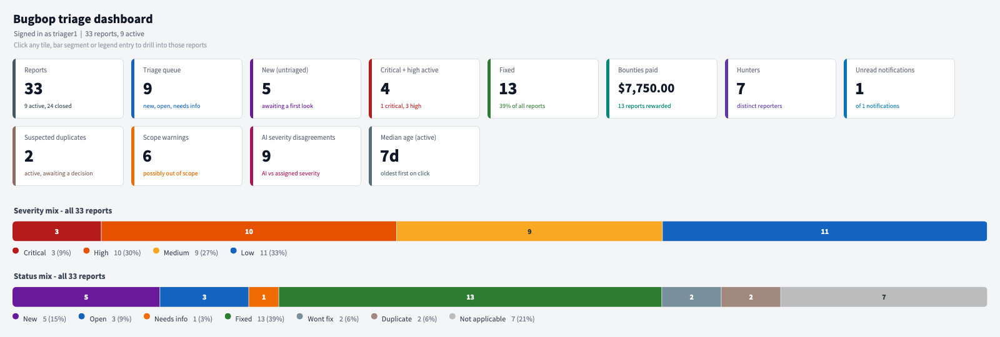

*All screenshots are rendered from offline examples with made-up data. See [Screenshots](#screenshots).*

## Load

```smalltalk
Metacello new
	repository: 'gitlocal:///Users/user/work/gtoolkit/gt4bugbop/src';
	baseline: 'Gt4Bugbop';
	load.
```

To reload the working copy into a running image (including uncommitted changes):

```smalltalk
(TonelReader
	on: '/Users/user/work/gtoolkit/gt4bugbop/src' asFileReference
	fileName: 'Gt4Bugbop') version load.
```

## Token

Create a token on the **API Tokens** tab of your Bugbop profile and save it to:

```
~/.secrets/bugbop-api-key.txt
```

`GtBugbopClient withApiKeyFromFile` reads it. The key is never displayed:

- Request history stores a copy with `Authorization: Bearer ***`.
- Redirects aren't followed, and `getUrl:` refuses hosts other than bugbop.com, so the token can't leak elsewhere.
- Webhook signing secrets are stripped from `rawData`.

## Explore

```smalltalk
GtBugbopExplorer withApiKeyFromFile
```

The explorer opens on the **Dashboard**. Its **Insights** tab leads to one object per question:

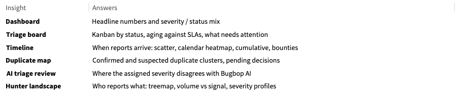

| Explorer view | What it shows |
|------|---------------|
| Dashboard | Metric tiles: triage queue, critical/high active, bounties, suspected duplicates, scope warnings, AI disagreements and median age. Also stacked severity and status bars |
| Insights | Entry points to the insight objects below |
| Board | The kanban from the triage board |
| Triage queue / All reports | Reports color-coded by severity and status |
| Severity x status | Count matrix |
| Hunters / Weekly activity / Programs / Notifications / Metrics / API calls | |

## Insights

Each insight is its own object (package tag `Insights`), so the explorer stays light. Build one from the explorer (`explorer triageBoard`) or from any reports group (`GtBugbopTriageBoard forReports: aGroup`).

### Triage board: `GtBugbopTriageBoard`

**Board** has one column per status, in workflow order. Cards have a severity stripe and an age badge colored by SLA. Badges flag scope warnings (`scope`), suspected duplicates (`dup?`) and AI severity disagreements (`AI: high`).

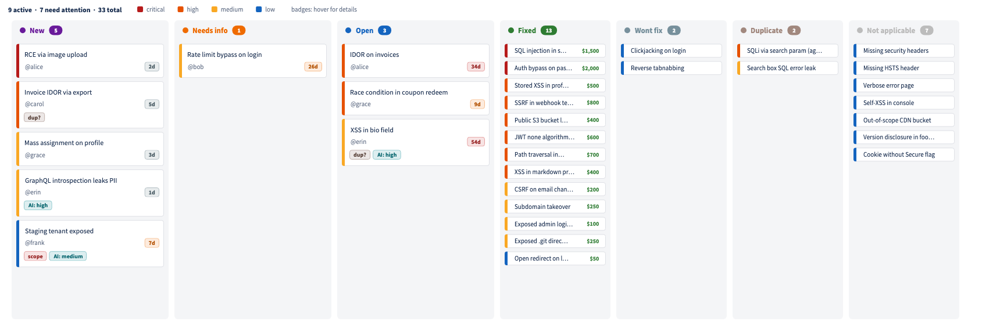

**Aging** shows active reports oldest first, against 7-day and 30-day SLA bands. **Attention** lists the reports that need action, each with its reason.

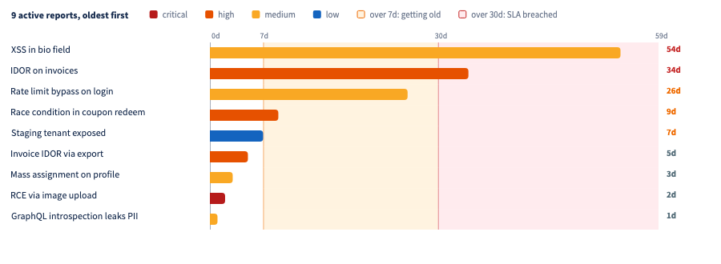

### Timeline: `GtBugbopReportTimeline`

**Timeline** has one lane per severity, with dots colored by status and sized by comment count. **Calendar** is a heatmap of submissions per day. **Cumulative** compares submitted with valid reports over time, and **Bounties** shows bounties per month.

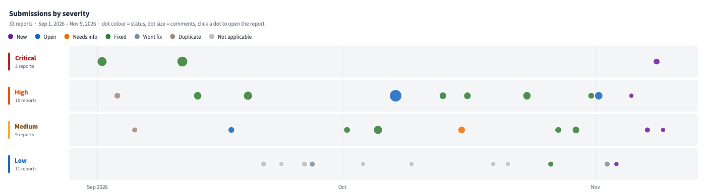

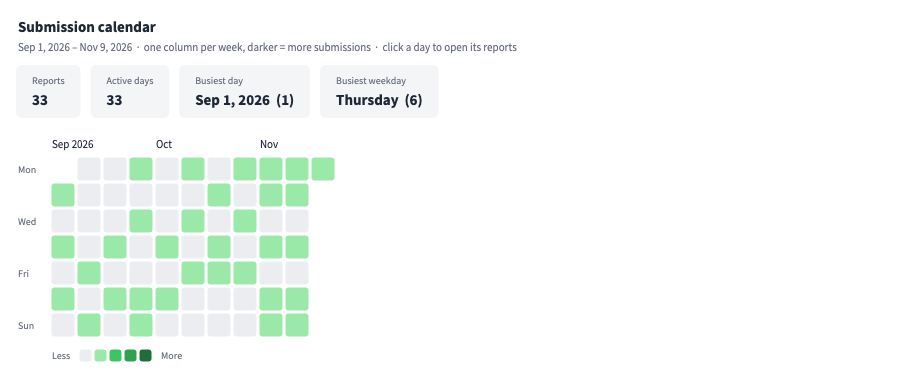

### Duplicate map: `GtBugbopDuplicateMap`

Duplicate clusters are drawn as Mondrian graphs. Solid arrows are confirmed duplicates and dashed arrows are suspected ones. Each cluster's canonical report gets a ring in its status color. Clusters with only suspected links are tagged *needs decision*. **Clusters** and **Pending suspicions** list them, and each `GtBugbopDuplicateCluster` has its own graph and a side-by-side comparison.

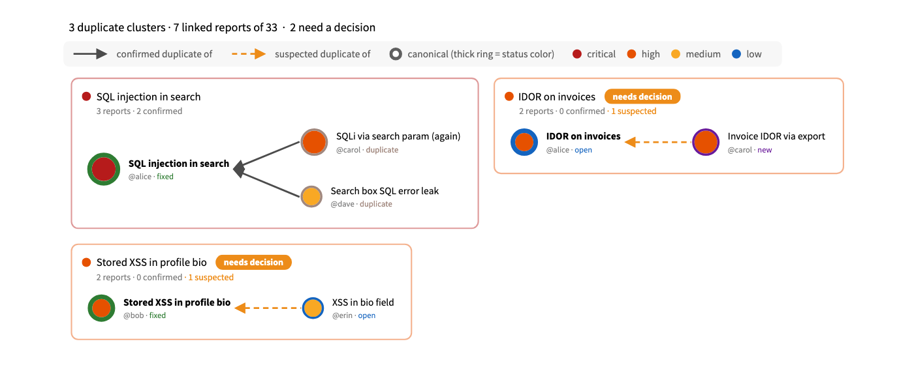

### AI triage review: `GtBugbopAiTriageReview`

The **Agreement matrix** compares the assigned severity with the one Bugbop's AI triage suggested, and shows the overall agreement rate. Clicking a cell opens its reports. **Disagreements** lists the mismatches, widest gap first.

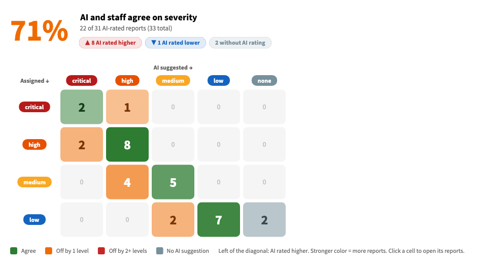

### Hunter landscape: `GtBugbopHunterLandscape`

**Treemap** sizes each hunter by reports filed and colors them by signal, the share of resolved reports that were valid. **Quadrant** plots volume against signal, with bubble size showing bounty. **Severity profile** gives each hunter a stacked severity bar. Hunters stay grey until 3 of their reports are resolved, so one closed report doesn't label anyone.

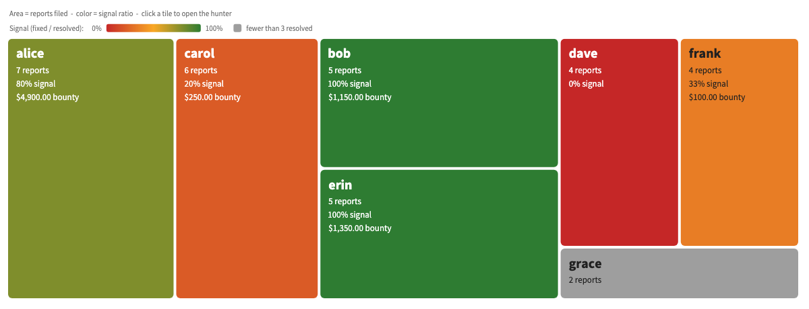

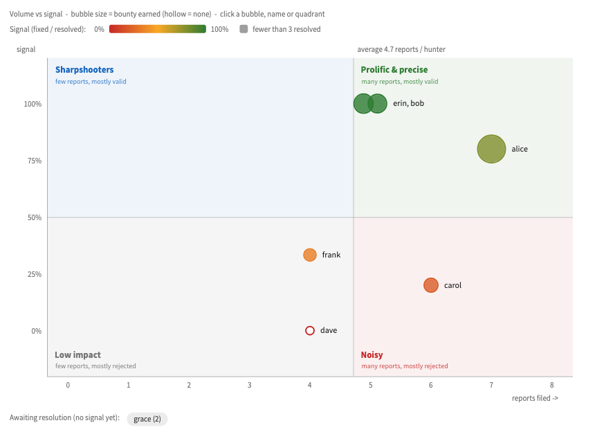

### Reports

A report opens on its **Card**. Pills show severity, status, AI disagreement, scope, and the duplicate the report is (or is suspected to be) a copy of; the duplicate pill opens that report. The other views are:

- Overview and Lifecycle (time to first response)
- Description, AI triage and Internal notes
- Comments and Conversation (chat bubbles, with hunter, program team and internal notes kept apart)
- Raw data, plus an "Open on bugbop.com" action

Each hunter also has a **Profile** card.

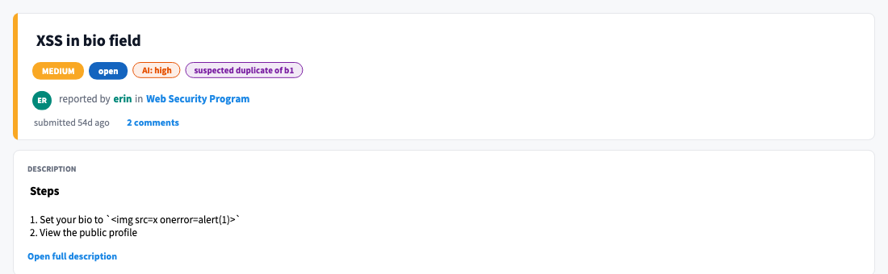

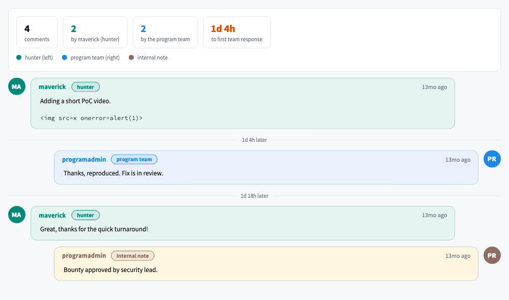

## Client API

```smalltalk
client := GtBugbopClient withApiKeyFromFile.
client currentUser.
client programs.
client reports.                                  "all pages, newest first"
client activeReports.                            "new, open, needs_info"
client reportsWithStatuses: #('new') severities: #('high' 'critical') since: nil.
client reportsUpdatedSince: 1 day ago.           "incremental sync"
(client reportAt: anId) comments.
client unreadNotifications.
```

Write operations go out to hunters by email or webhook, so they only run when you call them explicitly. No view, button or automated example calls them:
`updateReport:status:`, `updateReport:severity:`, `updateReport:internalNotes:`, `closeReport:asDuplicateOf:`, `addComment:toReport:`, `approveAccessRequest:message:`, `rejectAccessRequest:reason:`, `blockReporterOf:inProgram:`, `unblockReporter:`, `markNotificationsRead:`, `pingWebhook:`.

## Design

The package follows feenk's gt4llm HTTP clients (`GtLOpenAIClient`):

- **`GtBugbopClient`**: holds `apiKey`, `baseUrl`, `history` and `clientBuilder`. The class side reads `ApiKeyFile` from `~/.secrets`.
- **`GtBugbopClientZincBuilder`**: creates a configured `ZnClient` with bearer auth and JSON accept. It does not use `forJsonREST`, so an error body is parsed only after its status has been checked.
- **One `GtBugbopAPICommand` subclass per endpoint**: each defines `request` and `serializationClass`, and `perform` returns domain objects. Paginated endpoints subclass `GtBugbopListAPICommand`. It follows `Link: rel="next"` and stops early when given a `limit:`.
- **`GtBugbopEntity` subclasses**: built from JSON through `serializationProperties`. Each keeps the original JSON in `rawData`.
- **Groups**: built on `TGtGroupWithItems`, with type-preserving filters such as `active`, `withStatus:`, `byReporter:` and `matching:`.
- **Insight objects**: each takes a reports group and owns its views, built from Phlow, Mondrian, a treemap layout and Bloc/Brick elements. They share one severity and status palette, held on `GtBugbopReport` (`severityColorFor:`, `statusColorFor:`).
- **Bugbop specifics**:
  - `X-RateLimit-*` headers are tracked in `client rateLimit`.
  - A GET that gets a 429 is retried once if `Retry-After` is 60 seconds or less. Writes are never retried.
  - API errors raise `GtBugbopError`, which carries the status, Bugbop's message and any 422 field errors.

## Examples

- **`GtBugbopExamples`**: offline. It uses fixtures from the API docs and a stub `ZnClient` to cover:
  - parsing, pagination, `limit` and filters
  - 401, 404, 422 and 429 responses, and the retry policy
  - JSON bodies, token masking and the explorer
- **One examples class per insight**, also offline: `GtBugbopDashboardExamples`, `GtBugbopTriageBoardExamples`, `GtBugbopReportTimelineExamples`, `GtBugbopDuplicateMapExamples`, `GtBugbopAiTriageReviewExamples`, `GtBugbopHunterLandscapeExamples` and `GtBugbopReportVisualsExamples`.
- **`GtBugbopShowcaseExamples`**: a made-up 33-report program with dates relative to today, used for the screenshots.
- **`GtBugbopLiveExamples`** and the `live*` examples: read-only calls to the live API, marked `<noTest>`.

## Screenshots

The images in `docs/screenshots/` are generated from examples, so they always match the code. `GtBugbopScreenshots default` lists each shot: the example it comes from, the view, the size and the caption. Inspect it to preview them, or use its export action. To regenerate them all:

```smalltalk
GtBugbopScreenshots default
	exportTo: '/Users/user/work/gtoolkit/gt4bugbop/docs/screenshots' asFileReference
```

The shots only use offline examples; `GtBugbopExamples>>#screenshots` checks that none of them is a live example. That keeps real report, hunter and program data out of the repository.
